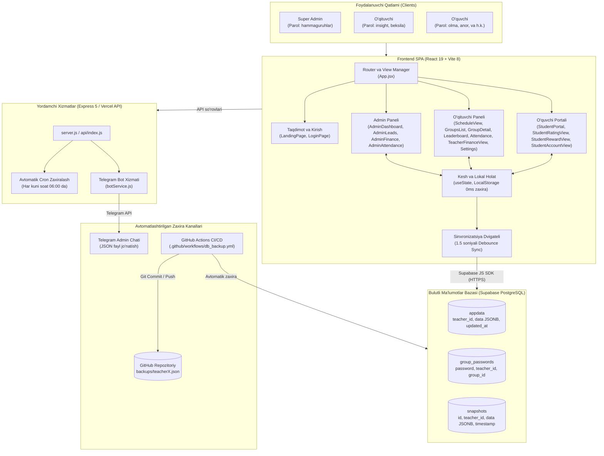
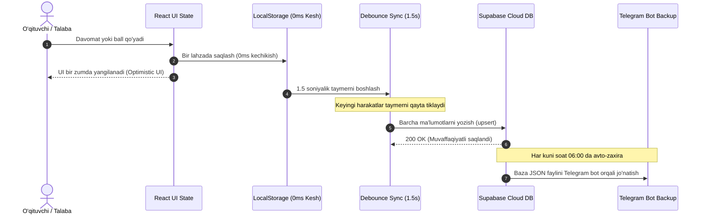

# "Epchil Robot: Rated Student App" — To'liq Tizim Arxitekturasi

Ushbu hujjat **"Epchil Robot: Rated Student App"** platformasining amaldagi dasturiy arxitekturasi, ma'lumotlar oqimi, xavfsizlik modeli, biznes mantiq algoritmlari va komponentlar strukturasini to'liq tavsiflaydi.

---

## 1. Loyiha Haqida Umumiy Tushuncha

**"Epchil Robot: Rated Student App"** — o'quv markazlari va ustozlar uchun mo'ljallangan talabalar reytingi (gamifikatsiya), dars jadvali, davomat nazorati, lidlar boshqaruvi (CRM) va kurs to'lovlari hisobini yurituvchi bulutli tizimdir.

Tizim **3 xil turdagi foydalanuvchilar** uchun xizmat ko'rsatadi:
1. **Super Admin** (`admin`) — Barcha o'qituvchilar faoliyati, umumiy o'quv markaz statistikasi, lidlar oqimi (CRM), o'qituvchilar davomati va umumiy moliyaviy hisobotlarni yagona boshqaruv panelidan nazorat qiladi.
2. **O'qituvchi** (`teacher`) — O'z dars jadvali, guruhlari, talabalar ro'yxati, dars davomati, rag'batlantiruvchi ballar/likelar, sovg'alar do'koni va oylik to'lovlar jurnalini to'liq mustaqil boshqaradi.
3. **O'quvchi** (`student`) — O'z guruhiga tegishli maxsus o'zbekcha so'z-parol (masalan: `olma`, `anor`) orqali kirib, shaxsiy reyting, to'plangan tangalar, unvonlar, davomat taqvimi, dars jadvali va avatar do'konidan foydalanadi (PIN-kod bilan himoyalangan profil).

---

## 2. Global Tizim Arxitekturasi



---

## 3. Foydalanuvchi Rollari va Avtorizatsiya Modeli (RBAC)

Tizimda bolalar va murabbiylar uchun murakkab login/email kiritmasdan, to'g'ridan-to'g'ri so'z-parollar orqali kirish imkonini beruvchi model amal qiladi:

| Rol | Kirish usuli | Ruxsat doirasi | Asosiy bo'limlar |
| :--- | :--- | :--- | :--- |
| **Super Admin** | `hammaguruhlar` | Barcha o'qituvchilar ma'lumotlarini o'qish, lidlar CRM, umumiy tahlil | `AdminDashboard`, `AdminLeads`, `AdminFinance`, `AdminAttendance` |
| **O'qituvchi** | `insight`, `beksila` | O'z guruhlari, talabalari, jadval, davomat va to'lovlarni to'liq boshqarish | `ScheduleView`, `GroupsList`, `Leaderboard`, `Attendance`, `TeacherFinanceView`, `Settings` |
| **O'quvchi** | Guruh so'z-paroli (`olma`, `anor`...) | Faqat o'z guruhi ma'lumotlarini o'qish, avatar do'koni, shaxsiy PIN | `StudentPortal` (Reyting, Do'kon, Davomat, Jadval, Ustoz profili) |

---

## 4. Modullar va Funksional Bo'limlar Tahlili

### 4.1. Super Admin Moduli
1. **AdminDashboard:**
   - O'quv markazining barcha faol o'qituvchilari bo'yicha umumiy statistika (guruhlar soni, talabalar soni, jami ballar).
   - O'qituvchilar bo'yicha filtrlash va tezkor saralash.
2. **AdminLeads (Lidlar CRM):**
   - O'quv markaziga yangi murojaat qilgan o'quvchilar ro'yxati (Ism, telefon raqam, qiziqqan yo'nalish, status: Yangi, Sinov darsi, To'lov qildi, Bekor qilindi).
   - Liddan to'g'ridan-to'g'ri haqiqiy o'quvchiga aylantirish (Convert to Student).
3. **AdminFinance (Umumiy Moliya):**
   - O'quv markazidagi barcha to'lovlar monitoringi, qarzdorliklar, oylik kurs tushumlari.
4. **AdminAttendance (Umumiy Davomat):**
   - Barcha o'qituvchilarning dars o'tish sifati, talabalarning darsga qatnashish foizi (KPI).

### 4.2. O'qituvchi Moduli
1. **ScheduleView (Dars Jadvali):**
   - Haftalik interaktiv dars jadvali (Juft kunlar, Toq kunlar, Shanba-Yakshanba).
   - Har bir darsning boshlanish va tugash vaqti, xonasi, darsga biriktirilgan talabalar soni.
   - Qo'shimcha / qayta tayyorlov darslarini (Extra Lessons) belgilash.
2. **GroupsList va GroupDetail (Guruhlar va Talabalar):**
   - Guruh yaratish, tahrirlash, arxivlash va dars vaqtlarini belgilash.
   - Talabalar ro'yxati, har bir talabaning joriy reytingi, to'plangan tangalari (coins), telefon raqami.
   - Talabani boshqa guruhga ko'chirish (Transfer student).
   - O'quvchi PIN-kodini tiklash / o'chirish.
3. **Leaderboard va Rewards (Reyting va Gamifikatsiya):**
   - Talabalarga darsdagi faolligi uchun ballar va tangalar berish (Tezkor teglar: Uy vazifasi, Faol ishtirok, Ajoyib javob va h.k.).
   - Sovg'alar do'koni katalogini boshqarish (Sovg'a nomi, narxi tangalarda, mavjudlik soni).
4. **Attendance (Davomat Jurnali):**
   - Guruh bo'yicha kunlik davomat belgilash (Bor, Yo'q, Sababli, Kechikdi).
   - Oylik davomat foizini avtomatik hisoblash.
5. **TeacherFinanceView (O'qituvchi Moliyasi):**
   - O'z guruhlaridagi o'quvchilarning oylik dars to'lovlarini belgilash, qarzdorlarni filtrlash.
6. **Settings (Sozlamalar va Zaxiralar):**
   - Tezkor baholash teglarini moslash.
   - O'chirilgan guruhlar va o'quvchilarni savatdan qayta tiklash (Soft-delete / Restore).
   - Baza zaxira nusxalarini yuklab olish, import qilish va avvalgi snapshot'ga qaytarish (Rollback).

### 4.3. O'quvchi Portali (StudentPortal)
1. **StudentRatingView (Reyting):**
   - Guruh ichidagi peshqadamlar jadvali, unvonlar tizimi (Boshlang'ich, Tajribali, Professional, Usta, Afsona).
2. **StudentRewardView (Avatar va Sovg'alar Do'koni):**
   - To'plangan tangalarga yangi avatarlarni sotib olish.
   - Avatar galereyasi va shaxsiy profilni bezash.
3. **StudentAccountView (Shaxsiy Kabinet va PIN Himoya):**
   - O'quvchi o'z profiliga 4 xonali shaxsiy PIN-kod o'rnatishi (boshqa o'quvchilar uning tangalarini sarflab yubormasligi uchun).
4. **StudentAttendanceCalendar va ScheduleCard:**
   - Shaxsiy davomat taqvimi va keyingi dars qachon bo'lishini ko'rsatuvchi karta.
5. **StudentTeacherShowcase:**
   - Guruh o'qituvchisi haqida ma'lumot, o'qituvchi bilan bog'lanish tugmalari.

---

## 5. Ma'lumotlar Modeli va Sxemasi

Asosiy bulutli ma'lumotlar bazasi sifatida **Supabase PostgreSQL** qo'llaniladi.

### 5.1. `appdata` Jadvali
Har bir o'qituvchi uchun yagona qatorda uning barcha operatsion ma'lumotlari JSONB formatida saqlanadi:
- `teacher_id` (VARCHAR, Primary Key) — masalan: `teacher1`.
- `updated_at` (TIMESTAMPTZ) — Oxirgi yangilanish vaqti.
- `data` (JSONB) — Butun ma'lumotlar daraxti:
  ```json
  {
    "groups": [
      {
        "id": "grp_123",
        "name": "Robo 1-bosqich",
        "schedule": "Du-Chor-Jum 15:00",
        "room": "Xona 3",
        "isArchived": false
      }
    ],
    "students": [
      {
        "id": "std_456",
        "groupId": "grp_123",
        "name": "Ali Valiyev",
        "coins": 150,
        "avatarKey": "robot-1",
        "pinHash": "...",
        "phone": "+998901234567"
      }
    ],
    "attendance": {
      "grp_123_2026-10-24": {
        "std_456": "present"
      }
    },
    "transactions": [
      {
        "id": "tx_789",
        "studentId": "std_456",
        "points": 10,
        "reason": "Uy vazifasi",
        "timestamp": 1729750000000
      }
    ],
    "leads": [],
    "payments": [],
    "rewards": [],
    "extraLessons": [],
    "teacherProfile": {
      "fullName": "Bekzod",
      "phone": "+998...",
      "bio": "Robototexnika ustozi"
    }
  }
  ```

### 5.2. `group_passwords` Jadvali
O'quvchilarning o'z guruhiga tezkor kirishi uchun qidiruv jadvali:
- `password` (VARCHAR, Primary Key) — Kichik harflarda yozilgan unikal o'zbekcha so'z (`olma`, `anor`).
- `teacher_id` (VARCHAR) — Guruh tegishli bo'lgan o'qituvchi IDsi.
- `group_id` (VARCHAR) — Guruhning unikal IDsi.

### 5.3. `snapshots` Jadvali
Har bir muhim o'zgarishdan oldingi xavfsizlik nuqtalari:
- `id` (BIGSERIAL, Primary Key)
- `teacher_id` (VARCHAR)
- `data` (JSONB)
- `timestamp` (TIMESTAMPTZ)

---

## 6. Sinxronizatsiya va Zaxiralash Mexanizmi



1. **Optimistic UI va 0ms Kesh:** Foydalanuvchi ball yoki davomat qo'yganida interfeys internet tezligini kutmasdan darhol yangilanadi va o'zgarishlar `localStorage` ga yoziladi.
2. **Debounce Sync (1.5 soniya):** Har bir mayda bosishda serverga so'rov yuborilmaydi. Oxirgi harakatdan so'ng 1.5 soniya o'tgach, barcha o'zgarishlar bitta paket bo'lib Supabase'ga yuboriladi.
3. **Avto-zaxira:** Har kuni soat 06:00 da `node-cron` orqali butun baza JSON formatida adminning Telegram botiga zaxira sifatida jo'natiladi.

---

## 7. Loyihaning Qat'iy Dizayn va Kodlash Qoidalari

Platforma yuqori darajadagi professional talablarga mos kelishi uchun quyidagi qat'iy standartlarga asoslanadi:

1. **Pulsatsiyalanuvchi LIVE neon taqiqlanadi:** Miltillovchi nuqtalar, neon nurlar, ko'zni charchatuvchi animatsiyalar mutlaqo yo'q. Barcha status belgilari sokin va statik Apple Minimalist uslubida.
2. **Standart emojilar taqiqlanadi:** Interfeysda standart smartfon emojilari ishlatilmaydi. Faqat toza vektor SVG piktogrammalar qo'llaniladi.
3. **Sun'iy intellekt (AI) shablon dizaynlari taqiqlanadi:** Binafsha-ko'k AI gradientlari, glassmorphism, nurlanuvchi yaltiroq effektlar, tartibsiz doiralar (blobs) ishlatilmaydi. Qat'iy neytral palitra va bitta asosiy urg'u rangi.
4. **Ortiqcha animatsiyalar cheklangan:** Sahifalar va modallar bir zumda, kechikishsiz almashadi. Faqat 150ms dan oshmaydigan bosiq hover/focus effektlariga ruxsat berilgan.

---

## 8. Papkalar va Fayllar Strukturasi

```
ratedStudentApp/
├── api/
│   └── index.js                   # Vercel Serverless API kirish nuqtasi
├── backups/                       # Lokal va git zaxira fayllari
├── public/                        # Statik rasmlar, avatarlar, manifest
├── scripts/                       # Zaxira va skript utilitalari
├── src/
│   ├── assets/                    # Ilovaning statik media fayllari
│   ├── components/
│   │   ├── admin/                 # Super Admin paneli komponentlari
│   │   │   ├── AdminAttendance.jsx
│   │   │   ├── AdminDashboard.jsx
│   │   │   ├── AdminFinance.jsx
│   │   │   └── AdminLeads.jsx
│   │   ├── common/                # Umumiy komponentlar (ErrorBoundary, ikonalar)
│   │   ├── student/               # O'quvchi portali va shaxsiy kabinet
│   │   │   ├── StudentAttendanceCalendar.jsx
│   │   │   ├── StudentPortal.jsx
│   │   │   ├── StudentRatingView.jsx
│   │   │   ├── StudentRewardView.jsx
│   │   │   └── StudentTeacherShowcase.jsx
│   │   ├── Attendance.jsx         # O'qituvchi davomat jurnali
│   │   ├── GroupDetail.jsx        # Guruh ichidagi talabalar va ballar
│   │   ├── GroupsList.jsx         # O'qituvchi guruhlar ro'yxati
│   │   ├── LandingPage.jsx        # Tashqi taqdimot va marketing sahifasi
│   │   ├── Leaderboard.jsx        # Reyting jadvali va sovg'alar
│   │   ├── LoginPage.jsx          # Tizimga kirish sahifasi
│   │   ├── ScheduleView.jsx       # Interaktiv dars jadvali
│   │   ├── Settings.jsx           # Sozlamalar va ma'lumotlar boshqaruvi
│   │   ├── Sidebar.jsx            # Asosiy navigatsiya menyusi
│   │   └── TeacherFinanceView.jsx # O'qituvchi to'lovlar jurnali
│   ├── hooks/                     # Custom React hooklar (modal, keyboard)
│   ├── utils/
│   │   ├── attendanceUtils.js     # Davomat hisob-kitob algoritmlari
│   │   ├── avatarGallery.js       # Avatarlar katalogi va filtrlash
│   │   ├── db.js                  # Lokal ma'lumotlar ombori boshqaruvi
│   │   ├── scheduleUtils.js       # Dars jadvali vaqt hisob-kitoblari
│   │   ├── supabase.js            # Supabase API mijoz va sinxronizatsiya
│   │   ├── teacherUtils.js        # O'qituvchi profili va KPI ko'rsatkichlari
│   │   └── telegram.js            # Telegram WebApp integratsiyasi
│   ├── App.jsx                    # Asosiy Router va Global State boshqaruvchisi
│   ├── index.css                  # Global Tailwind va rang o'zgaruvchilari
│   └── main.jsx                   # React dasturi kirish nuqtasi
├── botService.js                  # Telegram zaxira boti xizmati
├── package.json                   # Loyiha kutubxonalari va buyruqlari
├── server.js                      # Express lokal serveri va cron zaxira
└── vercel.json                    # Vercel joylashtirish va kesh konfiguratsiyasi
```
