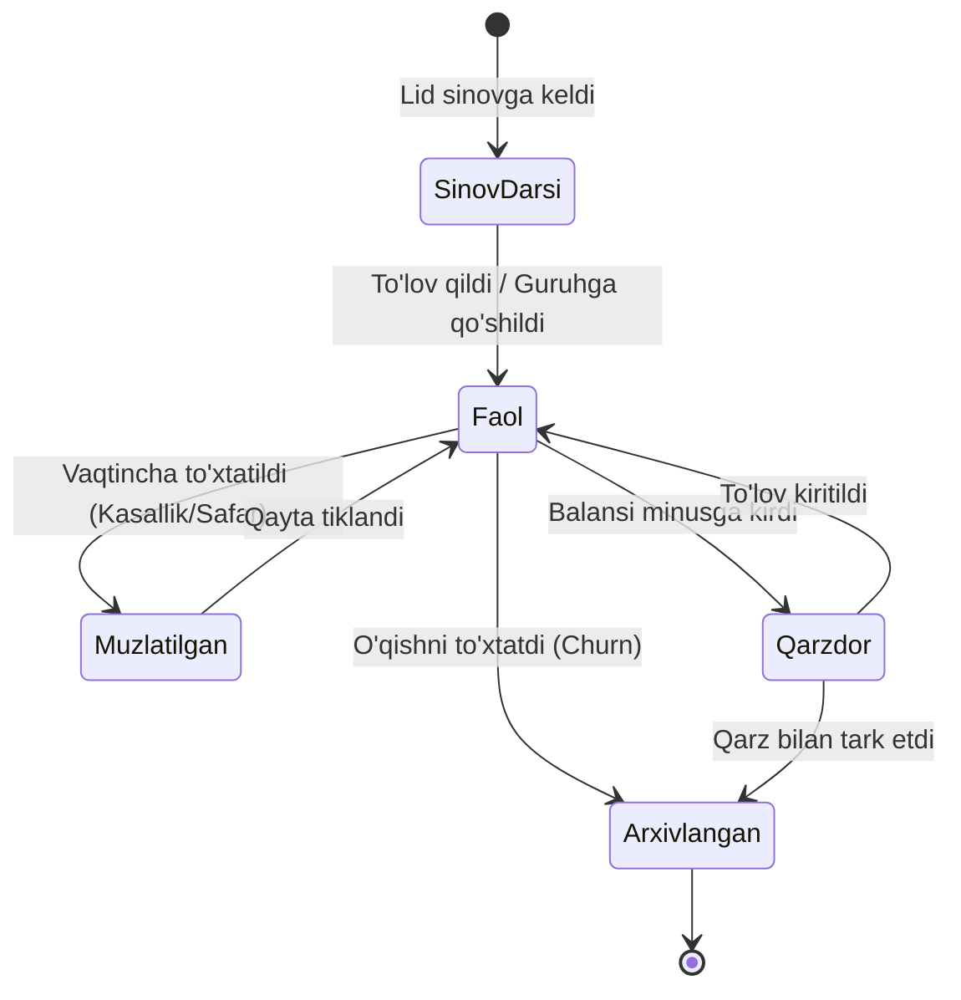

# Modme CRM Platformasi — Mukammal Qo'llanma va Texnik Yo'riqnoma

Ushbu qo'llanma **Modme CRM** (O'quv markazlari va ta'lim muassasalarini avtomatlashtirish platformasi) bo'yicha barcha kerakli ma'lumotlar, biznes mantiq, sozlamalar, to'lov rejimlari, integratsiyalar va ma'lumotlar oqimini o'z ichiga oladi. Shuningdek, ushbu ma'lumotlar **"Rated Student App" (Talabalar gamifikatsiyasi va reyting tizimi)** bilan qanday uyg'unlikda ishlashi va integratsiya qilinishi mumkinligi batafsil yoritilgan.

---

## Mundarija

1. [Modme CRM Umumiy Arxitekturasi va Ekologiyasi](#1-modme-crm-umumiy-arxitekturasi-va-ekologiyasi)
2. [Dastlabki Sozlamalar va Tizimni Ishga Tushirish (Onboarding)](#2-dastlabki-sozlamalar-va-tizimni-ishga-tushirish-onboarding)
3. [To'lov Rejimlari — Mukammal Tahlil (6 ta Rejim)](#3-tolov-rejimlari--mukammal-tahlil-6-ta-rejim)
4. [Lidlar (Mijozlar Voronkasi va Sotuv Bo'limi)](#4-lidlar-mijozlar-voronkasi-va-sotuv-bolimi)
5. [Guruhlar va Dars Jadvali (Timetable)](#5-guruhlar-va-dars-jadvali-timetable)
6. [Talabalar Boshqaruvi va Balans Tizimi](#6-talabalar-boshqaruvi-va-balans-tizimi)
7. [Davomat Nazorati (Attendance System)](#7-davomat-nazorati-attendance-system)
8. [Ustozlar va Xodimlar Maoshi (Payroll Engine)](#8-ustozlar-va-xodimlar-maoshi-payroll-engine)
9. [Foydalanuvchi Rollari va Ruxsatlar Tizimi (RBAC)](#9-foydalanuvchi-rollari-va-ruxsatlar-tizimi-rbac)
10. [SMS Xizmati va Avto-SMS Avtomatizatsiyasi](#10-sms-xizmati-va-avto-sms-avtomatizatsiyasi)
11. [Tashqi Integratsiyalar (Telefoniya, Workly, Telegram, Pixel, Uzum)](#11-tashqi-integratsiyalar-telefoniya-workly-telegram-pixel-uzum)
12. [Moliya, Tahlil va Dashboard Ko'rsatkichlari](#12-moliya-tahlil-va-dashboard-korsatkichlari)
13. [Excel Migratsiyasi (Excel -> Modme Import/Export)](#13-excel-migratsiyasi-excel---modme-importexport)
14. ["Rated Student App" Bilan Integratsiya va Ma'lumotlar Oqimi](#14-rated-student-app-bilan-integratsiya-va-malumotlar-oqimi)

---

## 1. Modme CRM Umumiy Arxitekturasi va Ekologiyasi

**Modme CRM** — O'zbekistondagi o'quv markazlari, xususiy maktablar va o'quv kurslari uchun ixtisoslashgan ERP/CRM ekotizimidir.

### Asosiy Qismlar:
* **Web Boshqaruv Paneli:** Rahbariyat (CEO), Filial direktorlari, Administratorlar, Kassirlar va Marketologlar uchun keng qamrovli veb-ilova.
* **Mobil Ilovalar:**
  * **Modme Teacher (Google Play & App Store):** O'qituvchilar dars jadvalini ko'rish, dars davomida davomat qilish, talabalar ro'yxatini va o'z maoshini kuzatish uchun.
  * **Modme Talaba / Student (Google Play & App Store):** Talabalar va ota-onalar dars jadvali, to'lovlar tarixi, qoldiq balans, davomat va uy vazifalarini kuzatib boradi.
* **Markaziy Ma'lumotlar Struktura Oqimi:**
  $$\text{Lid (So'rov)} \longrightarrow \text{Sinov Darsi} \longrightarrow \text{Talaba} \longrightarrow \text{Guruhga Biriktirish} \longrightarrow \text{Davomat + To'lov} \longrightarrow \text{Oylik Maosh}$$

---

## 2. Dastlabki Sozlamalar va Tizimni Ishga Tushirish (Onboarding)

O'quv markazini Modmega ulashda quyidagi qadamlar qat'iy tartibda bajarilishi shart:

```
[1. Kurslarni Yaratish] ➡️ [2. Xonalarni Kiritish] ➡️ [3. To'lov Rejimini Tanlash] ➡️ [4. Xodimlarni Qo'shish] ➡️ [5. Guruhlarni Ochish]
```

### 2.1 Kurslar (`Sozlamalar -> Kurslar`)
Har bir kurs uchun quyidagi ma'lumotlar belgilanadi:
* **Kurs nomi** (masalan: *Robototexnika Foundation*, *Python Backend*, *General English*);
* **Kurs davomiyligi** (oy hisobida: 3 oy, 6 oy, 9 oy...);
* **Haftalik dars soni va dars davomiyligi** (masalan: haftasiga 3 kun, 90 daqiqadan);
* **Kurs narxi** (1 oy uchun standart narx, masalan: 500 000 so'm);
* *Eslatma:* Kurs narxi o'zgartirilsa, unga yangi ochiladigan guruhlar yangi narxda ochiladi, ammo mavjud guruhlarning narxiga avtomatik ta'sir qilmasligi uchun ularni guruh tahrirlash orqali yangilash mumkin.

### 2.2 Xonalar (`Sozlamalar -> Xonalar`)
* **Xona nomi / raqami** (masalan: *Lab-1*, *Room 204*, *Robot Room*);
* **Sig'imi (Capacity):** Xonaga maksimal nechta o'quvchi sig'ishi mumkinligi (masalan: 12 yoki 16 nafar). Bu guruhga me'yordan ortiq o'quvchi qo'shilayotganda ogohlantirish beradi;
* **Bandlik jadvali:** Bir xonaga ayni bir vaqtda 2 ta guruh tushib qolishini (Cross-booking) oldini oladi.

### 2.3 Dam Olish Kunlari (`Sozlamalar -> Offis Sozlamalari -> Dam Olish Kunlari`)
* O'quv markazi ishlamaydigan rasmiy bayram kunlari, kanikullar kiritiladi;
* Tizim ushbu sanalarga dars jadvalida avtomatik ravishda dars qo'ymaydi va to'lov hisoblashda (agar kunlik rejimda bo'lsa) ushbu kunlarni chegirib tashlaydi.

### 2.4 Kvitansiya / Chek Sozlamalari (`Sozlamalar -> Umumiy -> Check`)
* Mijoz to'lov qilganda avtomatik kvitansiya (termal POS printer, 58mm/80mm) shakllanadi;
* Markaz logotipi, shior, ma'muriyat telefon raqami, QR kod va maxsus eslatmalar qo'shiladi;
* Talabaning eski qarzi, yangi to'lovi va to'lovdan keyingi qoldiq balansi chekda ko'rsatiladi.

---

## 3. To'lov Rejimlari — Mukammal Tahlil (6 ta Rejim)

Modme CRM markazning moliyaviy siyosatiga moslashish uchun 6 xil avtomatik balans yechish rejimini taqdim etadi. Ushbu rejim markaz ishga tushayotganda tanlanadi:

| Rejim | Qanday Ishlaydi? | Qachon Tanlash Kerak? | Asosiy Afzalligi |
| :--- | :--- | :--- | :--- |
| **1. Kalendar Rejimi** | Har oyning **1-sanasida** barcha faol o'quvchilardan to'liq oylik kurs narxi avtomatik yechiladi (1 oyda 11 ta yoki 13 ta dars bo'lishidan qat'iy nazar). | O'quvchilar bitta oqimda to'lov qiladigan klassik markazlar uchun. | Qarzdorlikni 1-sanada aniqlash, o'qituvchilarga oylik chiqarish juda oson. |
| **2. Guruh Boshlanish Sanasi** | Guruh ochilgan sanada yechiladi (masalan, guruh 14-oktabrda ochilgan bo'lsa, har oyning 14-sanasida yechiladi). | Guruhlar oyning turli kunlarida ochiladigan markazlar uchun. | Oyning o'rtasida ochilgan guruh uchun to'liq 1 oylik to'lov kafolatlanadi. |
| **3. Modul Rejimi** | Belgilangan darslar soni (masalan: **4, 8, 12, 20, 24 ta dars**) o'tilgach navbatdagi to'lov yechiladi. | Darsbay yoki blok-modul asosida o'qitiladigan intensiv kurslar. | Kalendar oyi bilan bog'liq bo'lmagan, aniq o'tilgan darslar soniga bog'langan adolatli to'lov. |
| **4. Kunlik Rejim** | Kurs narxi oyning darslar soniga bo'linadi (masalan: 300 000 / 12 = 25 000 so'm) va **har bir dars kuni** yechiladi. | O'quvchilar tez-tez guruh almashtiradigan yoki davomatga qat'iy bog'langan kurslar. | O'quvchi muzlatilsa yoki guruhdan chiqsa, unga ortiqcha pul qaytarish (refund) muammosi tug'ilmaydi. |
| **5. Individual Rejim** | Har bir o'quvchi guruhga qaysi kuni qo'shilgan bo'lsa, uning to'lovi har oy aynan o'sha kunda yechiladi (masalan: 7-sanada qo'shilsa, har oyning 7-sanasida). | O'quvchilar istalgan vaqtda guruhga qo'shiladigan markazlar. | Yangi talaba qo'shilganda murakkab qayta hisob-kitob (proration) talab qilinmaydi. |
| **6. To'liq Kurs Rejimi** | O'quvchi birinchi marta faollashtirilganda butun kurs uchun to'liq summa (masalan, 6 oylik kurs uchun 6 000 000 so'm) darhol qarz sifatida yoziladi. | Qat'iy kontrakt asosidagi kurslar yoki online videomateriallar sotuvi. | Talabaning butun kurs bo'yicha to'lov intizomini nazorat qilish oson. |

> [!IMPORTANT]
> To'lov rejimini o'zgartirish o'quv markazining barcha moliyaviy hisobotlariga bevosita ta'sir qiladi. Shuning uchun rejimni almashtirish faqat Modme texnik yordam xizmati orqali amalga oshiriladi.

---

## 4. Lidlar (Mijozlar Voronkasi va Sotuv Bo'limi)

Lidlar bo'limi — o'quv markazining sotuv voronkasi (Sales Pipeline) bo'lib, ijtimoiy tarmoqlar, qo'ng'iroqlar yoki saytdan tushgan qiziqishlarni talabaga aylantirish vazifasini bajaradi.

### 4.1 Section'lar va Kanban Ustunlar
* **Section:** Katta yo'nalishlar (masalan: *Dasturlash*, *Robototexnika*, *Til kurslari* yoki *Kuzgi qabul*).
* **Columns (Bosqichlar):**
  1. *Yangi lidlar (Inbox / New Leads)*
  2. *Bog'lanildi (Contacted / Call made)*
  3. *O'ylamoqda (Thinking / Follow-up)*
  4. *Sinov darsiga yozildi (Trial Scheduled)*
  5. *Sinov darsiga keldi (Attended Trial)*
  6. *Guruhga qo'shildi / To'lov qildi (Converted -> Won)*
  7. *Rad etdi (Lost / Archived)*

### 4.2 Manbalar (Lead Sources)
Mijoz qayerdan kelganini aniqlash:
* Instagram Ads / Bio link
* Telegram kanal / bot
* Facebook Ads
* Banner / Tashqi reklama
* Do'stining tavsiyasi (Word of mouth)
* Tashrif (Walk-in)

### 4.3 Maxsus Lid Formalar va Landing Page
* Modme ichida maxsus shakl (Lead Form) yaratiladi.
* Har bir shakl o'zining noyob URL havolasiga ega bo'ladi (Instagram Bio yoki Telegram postlarga qo'yish uchun).
* Shakl orqali mijoz Ismi, Telefon raqami, Qiziqqan fani va qulay vaqtini tanlaydi. Ma'lumot to'g'ridan-to'g'ri Modme CRM'ning tegishli ustuniga kelib tushadi.

### 4.4 Naborlar (Guruh Qabuli)
* Yangi ochilayotgan guruh uchun "Nabor" ochiladi.
* Lidlar guruhga talabgor sifatida ro'yxatga olinadi. Kerakli minimal o'quvchilar soni (masalan, 10 nafar) yig'ilganda, ularning barchasi bitta tugma bilan faol guruhga o'tkaziladi.

### 4.5 Lid Arxivi va Arxivlash Sabablari
* Yo'qotilgan lidlar o'chirib yuborilmaydi, balki arxivlanadi.
* **Arxiv sabablari kiritilishi shart:** *Narxi qimmatlik qildi*, *Vaqti to'g'ri kelmadi*, *Manzil uzoqlik qildi*, *Raqobatchiga ketdi*, *Javob bermadi*.
* Bu marketing bo'limiga sotuvdagi xatolarni tahlil qilish imkonini beradi.

---

## 5. Guruhlar va Dars Jadvali (Timetable)

Guruhlar — o'quv jarayonining yuragi hisoblanadi.

### 5.1 Guruh Yaratish Parametrlari:
* **Guruh nomi:** (Masalan: *Robo-14:00-Juft*);
* **Kurs:** Tegishli kurs biriktiriladi (narx va muddat kursdan olinadi);
* **O'qituvchi:** Asosiy ustoz biriktiriladi;
* **Xona:** Dars xonasi tanlanadi;
* **Dars kunlari:** Dushanba-Chorshanba-Juma (Toq) yoki Seshanba-Payshanba-Shanba (Juft) yoki Har kuni / Maxsus kunlar;
* **Dars vaqti:** Darsning boshlanish va tugash vaqti (masalan: 14:00 - 15:30);
* **Guruh boshlanish sanasi va kutilayotgan tugash sanasi.**

### 5.2 Dars Jadvali (Timetable):
* Xonalar va o'qituvchilar bo'yicha to'liq vizual taqvim.
* Bo'sh vaqt oralig'i (Slotlar) ko'rinadi, yangi guruhlarni joylashtirish qulaylashadi.
* **Dars sanasini ko'chirish:** Agar bayram yoki boshqa sabab bilan dars bo'lmasa, dars sanasi boshqa kunga ko'chiriladi.
* **Darsni bekor qilish:** O'tilmagan dars bekor qilinadi (kunlik rejimda pul yechilmaydi).

### 5.3 Imtihonlar (Exams Module):
* Guruh ichida oraliq yoki yakuniy imtihon sanasi belgilanadi.
* **Maksimal ball** (masalan: 100 ball) va **O'tish bali** (masalan: 70 ball) belgilanadi.
* O'qituvchi o'quvchilar to'plagan ballarni kiritadi. Ushbu natijalar talaba profilida va mobil ilovada ko'rinadi.

### 5.4 Chegirmalar (Discounts):
* Agar talabaga maxsus chegirma berilsa (masalan: 20% doimiy chegirma yoki bitta oiladan 2 ta farzand chegirmasi), bu guruh ichida belgilab qo'yiladi.
* Tizim avtomatik to'lov yechayotganda ushbu chegirmali narxni hisobga oladi.

---

## 6. Talabalar Boshqaruvi va Balans Tizimi

### 6.1 Talabaning 5 Xil Holati (Statuslari)



1. **Faol (Active):** Guruhda faol o'qiyotgan, to'lovlari o'z vaqtida bo'lgan o'quvchi.
2. **Sinov darsida (Trial):** 1-darsga sinov uchun kelgan o'quvchi (hali to'lov yechilmaydi).
3. **Muzlatilgan (Frozen):** O'quvchi kasal bo'lsa yoki safarga ketsa, balansi va davomati ma'lum muddatga muzlatiladi. Bu vaqtda undan pul yechilmaydi.
4. **Qarzdor (Debtor):** To'lov muddati kelgan, lekin to'lov qilinmagan o'quvchi (balansi salbiy `-`).
5. **Arxivlangan (Archived):** O'qishni tugatgan yoki markazdan ketgan o'quvchi. Tarixi saqlanadi, qayta tiklash mumkin.

### 6.2 To'lov Kiritish Mexanizmi
To'lov 2 xil usulda kiritiladi:
1. **Talabalar ro'yxatidagi (⋯) menyusi orqali tezkor to'lov.**
2. **Talaba profiliga kirib "To'lov" tugmasi orqali.**

**To'lov parametrlari:**
* To'lov summasi (so'mda);
* To'lov qilinayotgan guruh (agar talaba bir nechta fanga qatnashsa);
* To'lov turi: Naqd, Plastik karta, Click/Payme, Bank hisobi;
* To'lov sanasi;
* Izoh (kvitansiya raqami yoki to'lovchi ismi).

### 6.3 To'lovlar Tarixi va Bekor Qilish
* Barcha to'lovlar profilning "To'lovlar tarixi" qismida saqlanadi.
* Agar xato summa kiritilgan bo'lsa, **CEO** yoki **Filial Direktori** roliga ega xodim to'lovni tahrirlashi yoki butunlay o'chirib yuborishi mumkin.

---

## 7. Davomat Nazorati (Attendance System)

Davomat nafaqat talabaning darsga qatnashishini, balki to'lov yechilishini va o'qituvchi maoshini belgilovchi eng muhim moduldir.

### 7.1 Davomat Belgilash Qoidalari:
* Kalendarda faqat dars kunlari yacheykalari ko'rinadi.
* Har bir talaba qarshisida **"Ha" (Keldi)** yoki **"Yo'q" (Kelmadi)** belgilanadi.
* **Dars mavzusi (Lesson Topic):** O'qituvchi o'tgan dars mavzusini kalendar katagiga yozib qo'yishi mumkin.

### 7.2 Ruxsat Cheklovlari (Permissions):
* **CEO / Filial Direktori / Administrator:** Hozirgi va o'tgan barcha kunlardagi davomatni ko'ra oladi va istalgan paytda tahrirlashi mumkin.
* **O'qituvchi (Teacher):**
  * Standart holda: Faqat **bugungi dars** kunida davomat qila oladi.
  * Qat'iy rejim yoqilsa: Faqat **dars vaqti oralig'ida** (masalan, 14:00 dan 15:30 gacha) davomat qila oladi. Dars tugagach davomat bloklanadi (administratorga murojaat qilish kerak bo'ladi).

### 7.3 Kelajak Sanalar:
* Hech bir xodim kelajakdagi dars sanalariga oldindan davomat qo'ya olmaydi.

---

## 8. Ustozlar va Xodimlar Maoshi (Payroll Engine)

Modme CRM ustozlarga ish haqi hisoblash bo'yicha nihoyatda moslashuvchan (flexible) hisob-kitob dvigateliga ega:

### 8.1 Fiks (O'zgarmas) Maosh
* O'qituvchiga har oy uchun qat'iy oylik belgilanadi (masalan: 5 000 000 so'm). Talabalar soni yoki dars soniga bog'liq bo'lmaydi.

### 8.2 Foizli va O'zgaruvchan Maosh Modellar (8 xil yondashuv):
1. **Yagona foiz:** Barcha ustozlar uchun kurs narxining yagona foizi (masalan, barchaga 40%).
2. **Ustoz bo'yicha individual foiz:** Tajribali ustozga 50%, yangi ustozga 35%.
3. **Kurs bo'yicha alohida foiz:** Murakkab kursga (Robototexnika) 45%, oson kursga 30%.
4. **Guruh bo'yicha alohida foiz:** Talabasi ko'p guruhga 40%, mini-guruhga 50%.
5. **Real tushumga bog'langan foiz:** Ustozga faqatgina **haqiqatda to'lov qilgan** talabalarning pulidan foiz beriladi (qarzdorlarning puli hisoblanmaydi).
6. **Talaba bo'yicha individual foiz:** Maxsus shartnomadagi o'quvchilarga alohida foiz.
7. **Talaba boshiga fiks summa:** Har bir o'quvchi uchun aniq stavka (masalan: 1 ta o'quvchiga 100 000 so'm). 15 ta o'quvchi bo'lsa = 1 500 000 so'm.
8. **Dars boshiga fiks summa:** Har bir o'tilgan 1 ta dars uchun haq to'lash.

### 8.3 Muhim Sozlamalar:
* **Davomatga bog'lash:** Darsda davomat qilinmasa, dars o'tilmagan deb topiladi va oylikka qo'shilmaydi.
* **Chegirmalarni inobatga olish:** Agar talabaga 20% chegirma berilgan bo'lsa, ustozning ulushi ham shu chegirmaga mutanosib qisqaradi.
* **Sinov darsi:** Sinov darsidagi talabalar oylikka qo'shilsinmi yoki yo'qmi sozlanadi.
* **Arxivlanganlar:** O'rtada ketib qolgan talabalar maoshga qanday ta'sir qilishi boshqariladi.

---

## 9. Foydalanuvchi Rollari va Ruxsatlar Tizimi (RBAC)

Modme tizimida rollar keskin taqsimlangan bo'lib, har bir xodim faqat o'ziga tegishli maydonda ishlaydi:

| Rol | Ruxsatlar va Huquqlar | Cheklovlar |
| :--- | :--- | :--- |
| **CEO (Bosh Direktor)** | Barcha filiallar, sozlamalar, billing, xodimlar, moliya va to'liq audit nazorati. | Hech qanday cheklov yo'q. |
| **Filial Direktori** | O'z filialidagi barcha guruhlar, talabalar, xodimlar, davomat va kassa amallari. | Boshqa filiallarga va global billing sozlamalariga kira olmaydi. |
| **Administrator** | Lidlar, guruhlar, talabalar, ustozlar, dars jadvali, ro'yxatga olish, davomat. | Moliya, xarajatlar va chuqur moliyaviy hisobotlar yopiq. |
| **Administrator 2** | Administrator huquqlari + o'chirish va to'liq tahrirlash huquqlari. | Moliya yopiq. |
| **Limited Administrator** | Faqat yangi lid/talaba qo'shish va davomat belgilash. | Tahrirlash, o'chirish, telefon raqamlarni ko'rish cheklangan bo'lishi mumkin. |
| **O'qituvchi (Teacher)** | Faqat o'z guruhlari, o'quvchilari, dars jadvali, davomat qo'yish va o'z maoshi. | Boshqa guruhlar, boshqa ustozlar va moliya bo'limi ko'rinmaydi. |
| **Kassir / Hisobchi** | Talabalar balansi, to'lov qabul qilish, kassa, xarajatlar, to'lovlar tarixi. | O'quv metodikasi, dars jadvali tahriri yopiq. |
| **Marketer** | Faqat lidlar bo'limi, kanban, lid formalar, konversiya hisobotlari va teglar. | Talabalar balansi, oylik maoshlar yopiq. |
| **Talaba (Student)** | O'z profili, to'lovlar tarixi, qoldiq balans, o'z guruhining jadvali va ballari. | Faqat Read-only (faqat o'qish uchun). |

---

## 10. SMS Xizmati va Avto-SMS Avtomatizatsiyasi

Modme CRM O'zbekistonning ikkita yetakchi SMS shlyuz provayderi bilan to'g'ridan-to'g'ri integratsiyalashgan:
1. **PlayMobile.uz** (Login, Parol, Originator / Alfanomer orqali)
2. **Eskiz.uz** (Login, Parol, SMS Shlyuz tokeni orqali)

### 10.1 Asosiy 6 ta Avto-SMS Triggerlari:

```
[Hodisa: To'lov sanasiga 2 kun qoldi] ──> Avto-SMS: "Oldindan to'lov eslatmasi"
[Hodisa: Balans minusga tushdi]       ──> Avto-SMS: "Qarzdorlik haqida ogohlantirish"
[Hodisa: Yangi guruhga qo'shildi]      ──> Avto-SMS: "Xush kelibsiz! Dars vaqti va xona"
[Hodisa: Kassa to'lov qabul qildi]     ──> Avto-SMS: "To'lovingiz qabul qilindi (Chek)"
[Hodisa: Bugun talabaning tavalludi]   ──> Avto-SMS: "Tug'ilgan kun tabrigi"
[Hodisa: Davomatda 'Yo'q' qo'yildi]    ──> Avto-SMS: "Ota-onaga: Farzandingiz darsga kelmadi"
```

### 10.2 SMS Shablonlaridagi O'zgaruvchilar (Variables):
Shablon matniga avtomatik to'ldiriluvchi o'zgaruvchilar qo'yiladi:
* `%student_name%` — Talabaning ismi
* `%student_surname%` — Talabaning familiyasi
* `%group_name%` — Guruh nomi
* `%course_name%` — Kurs nomi
* `%teacher_name%` — Ustozning ismi
* `%room_name%` — Xona nomi
* `%debt_amount%` — Qarzdorlik summasi
* `%payment_amount%` — To'langan summa
* `%lesson_time%` — Dars boshlanish vaqti

---

## 11. Tashqi Integratsiyalar (Telefoniya, Workly, Telegram, Pixel, Uzum)

### 11.1 IP Telefoniya Integratsiyasi
* **Hamkorlar:** OnlinePBX.ru, Hostmaster, IstTelecom (SIP trank).
* **Qanday ishlaydi:**
  * Modme ichida brauzerning o'zida yashil telefon vidjeti paydo bo'ladi (WebRTC orqali).
  * Talaba raqamiga bitta bosish orqali qo'ng'iroq amalga oshiriladi (Click-to-Call).
  * Kiruvchi qo'ng'iroqda ekranda mijozning ismi va oxirgi izohlari kartochka bo'lib ochiladi.
  * Barcha qo'ng'iroqlar audio yozuvi Modmedagi talaba profiliga saqlanadi.

### 11.2 Workly.io Integratsiyasi (Xodimlar nazorati)
* Xodimlarning ishga kelish va ketishini biometrik (barmoq izi yoki Face ID) nazorat qiluvchi qurilmalar Modmega ulanadi.
* **Talab qilinadigan parametrlar:** `Workly Client ID`, `Workly Secret`, `Workly Username`, `Workly Password`.
* Modme "Hisobotlar -> Workly" bo'limida har bir xodimning kechikishlari, ish soatlari va qoldirgan kunlari avtomatik hisoblanadi.

### 11.3 Telegram for Reports (`@modme_robot`)
* Markaz rahbarlari Telegram orqali har kuni avtomatik jamlanma hisobot oladi.
* **Ulanish tartibi:**
  1. Telegramda `@getidsbot` orqali shaxsiy `Telegram ID` aniqlanadi.
  2. Modme `Sozlamalar -> Integratsiyalar` bo'limidagi `Telegram for Report` maydoniga ID kiritiladi.
  3. `@modme_robot` botiga kirib `/start` bosiladi.
  4. Har kuni kechki payt kassa tushumi, yangi lidlar, kelgan-ketgan talabalar soni hisoboti yuboriladi.

### 11.4 Meta / Facebook Pixel
* Facebook Ads orqali reklama berganda, qaysi reklama qancha lid olib kelganini va konversiyasini kuzatish uchun `Pixel ID` Modme sozlamalariga joylanadi.

### 11.5 Uzum Integratsiyasi
* O'quvchilarga Uzum to'lov tizimi orqali to'lovlarni onlayn qabul qilish imkonini beradi.

---

## 12. Moliya, Tahlil va Dashboard Ko'rsatkichlari

### 12.1 Muhim Tushuncha: Dashboard vs Talabalar Bo'limi
Modmedan foydalanuvchilar tez-tez uchratadigan holat:
* **Talabalar bo'limidagi son:** Bu markazga kelayotgan haqiqiy **noyob odamlar (jismoniy shaxslar)** soni.
* **Dashboard bo'limidagi "Faol talabalar":** Bu **to'lov o'rinlari (talaba-o'rin / student-seats)** soni.
* *Misol:* 1 nafar o'quvchi bir vaqtning o'zida ham *Robototexnika*, ham *Ingliz tili*, ham *Mental arifmetika* kurslariga to'lov qilib qatnashsa, u Talabalar bo'limida **1 ta** bo'lib ko'rinadi, lekin Dashboardda **3 ta faol talaba/o'rin** sifatida aks etadi.

### 12.2 Moliya Bo'limi:
* **Barcha to'lovlar:** Kassa, bank va kartadan tushgan har bir so'm tranzaksiyalari.
* **Yechib olishlar:** Balansdan avtomatik kurs narxi yechilish jurnali.
* **Xarajatlar (Expenses):** Ijara, oyliklar, kanselyariya, soliqlar, marketing xarajatlari kiritiladi va sof foyda (Net Profit) hisoblanadi.
* **Qarzdorlar ro'yxati:** Qarz miqdori, muddati va sababi bo'yicha filterlar.

### 12.3 Hisobotlar va Metrikalar:
* **Konversiya hisoboti:** Reklamaga tushgan 100 ta liddan nechtasi guruhga keldi va to'lov qildi?
* **Davomat hisoboti:** Qaysi guruh va qaysi ustozda qatnashish foizi yuqori?
* **Guruhni tark etganlar (Churn Rate):** Talabalar nima sababdan kursni tashlab ketmoqda? (Tahlil: ustoz sababli, narx sababli, vaqt sababli).
* **Audit - Roadmap (10 ballik tizim):** Modme ichida markazni audit qilish yo'l xaritasi mavjud (Marketing, Sotuv, Mijozlarga xizmat, O'quv sifati bo'yicha o'z-o'zini baholash).

---

## 13. Excel Migratsiyasi (Excel -> Modme Import/Export)

Eski tizimdan yoki Excel jadvallardan Modmega ko'chishda ikkita asosiy fayl ishlatiladi:

### 13.1 So'rovlar (Lidlar) Import Ustunlari:
1. **Mijozning Ism-Familiyasi** (Majburiy)
2. **Telefon raqami** (+998901234567 formatida)
3. **Mijoz manbasi** (Instagram, Telegram, Banner...)
4. **Izohlar**

### 13.2 Talabalar Import Ustunlari:
1. **Talabaning Ism-Familiyasi** (Majburiy)
2. **Asosiy telefon raqami**
3. **Tug'ilgan sanasi** (YYYY-MM-DD yoki DD.MM.YYYY)
4. **Qo'shimcha telefon raqam** (Ota-onasi)
5. **Izohlar**

*Eksport:* Modmedagi barcha lidlar, faol talabalar, qarzdorlar va to'lovlar tarixini istalgan paytda bitta tugma bilan `.xlsx` (Excel) formatida yuklab olish mumkin.

---

## 14. "Rated Student App" Bilan Integratsiya va Ma'lumotlar Oqimi

Hozirgi ishlab chiqilayotgan **"Epchil Robot: Rated Student App"** loyihamiz va **Modme CRM** bir-birini inkor qilmaydi, balki bir-birini to'ldiradi.

### 14.1 Vazifalar Taqsimoti (Synergy Matrix):

```
┌──────────────────────────────────────┐       ┌──────────────────────────────────────┐
│              MODME CRM               │       │          RATED STUDENT APP           │
│   (Boshqaruv va Moliya Yuragi)      │       │     (Gamifikatsiya va Motivatsiya)   │
├──────────────────────────────────────┤       ├──────────────────────────────────────┤
│ • Sotuv voronkasi (Lidlar)           │       │ • Talabalar Reytingi (Leaderboard)   │
│ • Shartnomalar va Kassa to'lovlari   │       │ • Ballar, Likelar va Koinlar tarixi  │
│ • Qarzdorlik nazorati va Avto-SMS    │       │ • Qiziqarli Avatarlar va Badjlar     │
│ • Rasmiy davomat va Ota-onaga SMS    │       │ • Bolalar uchun o'zbekcha parollar   │
│ • O'qituvchilar oylik maoshi hisobi  │       │ • Darsdagi faollik va musobaqa ruhi  │
│ • Xodimlar biometrikasi (Workly)     │       │ • O'quvchi mustaqil ko'radigan ekran │
└──────────────────────────────────────┘       └──────────────────────────────────────┘
                   ▲                                               ▲
                   └───────────────────────┬───────────────────────┘
                                           │
                           MA'LUMOTLAR SINXRONIZATSIYASI
```

### 14.2 Ma'lumotlarni Bog'lash Sxemasi:
1. **Yagona Kalit (Primary Key):**
   * Talabaning telefon raqami yoki Modme'dagi `student_id` raqami `Rated Student App`dagi talaba profili bilan moslashtiriladi.
2. **Guruhlar Muvofiqligi:**
   * Modme'dagi guruh nomlari (masalan: `Robo-Foundation-1`) bizning ilovamizdagi `group_id` bilan bir xil yuritiladi.
3. **Ma'lumotlarni Yuklash (Sync Workflow):**
   * **Bosqich 1 (Hozirgi holat):** Modmedan talabalar ro'yxati Excel/CSV qilib olinadi va `seed_template_data.js` orqali bizning Supabase bazamizga kiritiladi.
   * **Bosqich 2 (Avtomatlashtirish):** Modme Webhook yoki REST API orqali yangi o'quvchi qo'shilganda yoki davomat qilinganda bizning backendimizga (`server.js / /api/webhook`) xabar kelib tushadi va `Rated Student App` o'z reytingini avtomatik yangilaydi.
4. **Gamifikatsiya Koinlari:**
   * Modme CRM ichida ham sodda coinlar tizimi mavjud. Bizning tizimimiz esa ushbu koinlarni vizual avatar, sovrinlar, darajalar (Level 1, Level 2...) va guruhlararo raqobat bilan boyitib beradi.

---

## Xulosa va Tavsiyalar

1. **To'lov rejimini tanlash:** Markazingiz xususiyatidan kelib chiqib, agar darslar barqaror 1-sanadan boshlansa **Kalendar rejimi**, agar guruhlar oy davomida ochilsa **Guruh boshlanish sanasi** yoki **Kunlik rejim**ni tanlang.
2. **Davomat intizomi:** O'qituvchilarga davomatni faqat dars vaqtida qo'yish cheklovini yoqing. Bu ustozlarning mas'uliyatini oshiradi va oylik hisob-kitoblarida xatoliklarni bartaraf etadi.
3. **SMS xabarnomalar:** Ota-onalarga dars qoldirilganda va to'lov qabul qilinganda boradigan 2 ta avto-SMSni darhol ishga tushiring — bu mijozlar ishonchini 80% ga oshiradi.
4. **Bizning App bilan integratsiya:** Modme orqali markazning puli va xodimlarini nazorat qiling, **Rated Student App** orqali esa bolalarning darsga qiziqishi, musobaqa ruhi va markazda uzoq muddat qolishini (Retention Rate) ta'minlang!
